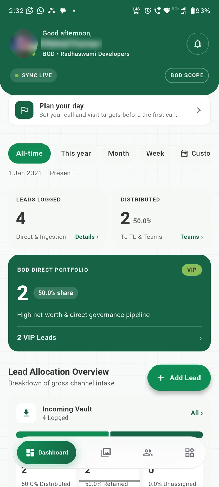
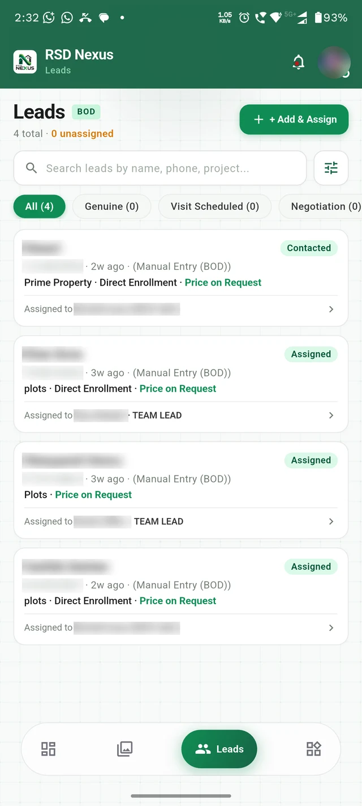
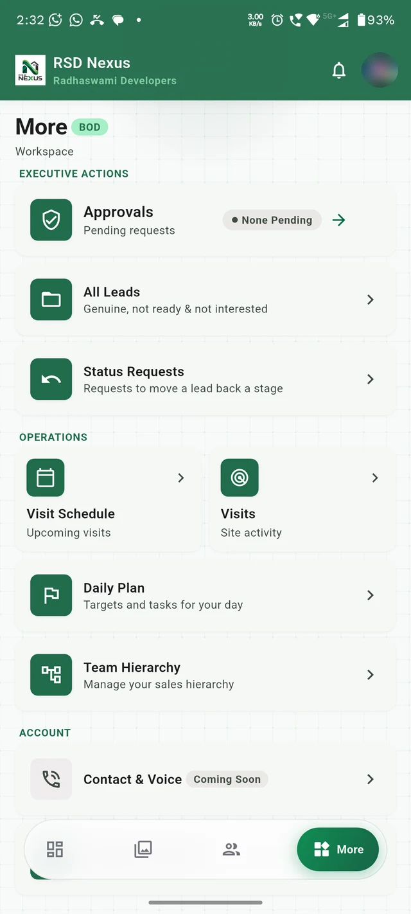
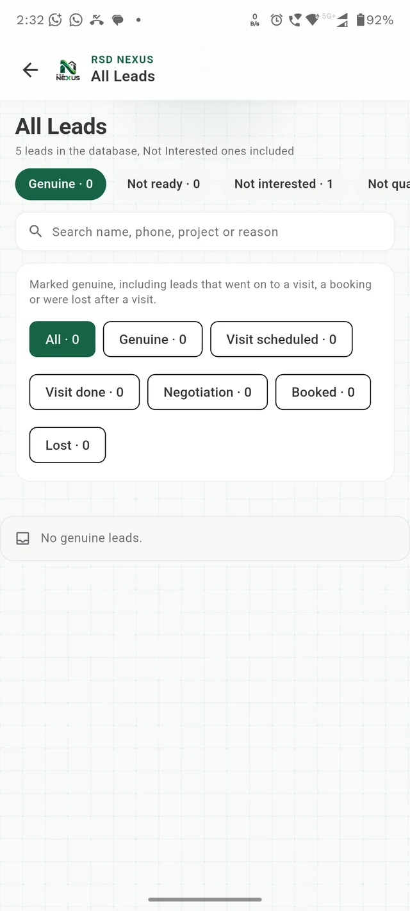
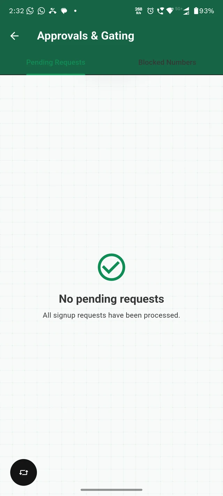
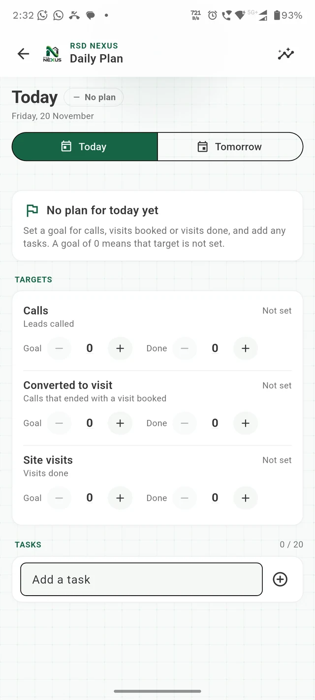
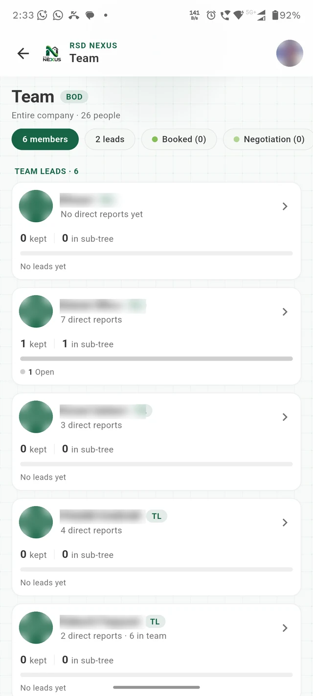
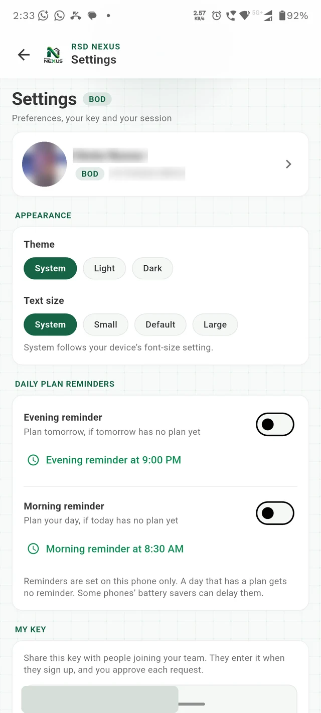
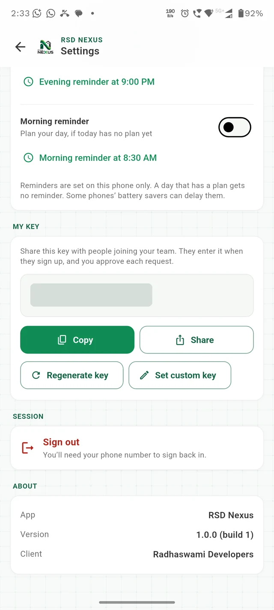

  

<h1 align="center">RSD Nexus</h1>

  A mobile CRM for real-estate sales teams, built for <b>Radhaswami Developers</b>. 
  Flutter · Riverpod · Firebase

> **Showcase repository.** It contains documentation and redacted screenshots only. The source code, Firebase configuration and real data are in a private repository. Names, phone numbers, profile photos and sign-up keys in the screenshots are blurred.

---

## What it is

RSD Nexus takes a lead from a Meta Ads spreadsheet to a booked site visit. A director uploads the leads and hands them down a sales hierarchy. Each salesperson moves their leads through a fixed pipeline, with a note at the key stages. Every status change is recorded in an audit log. Directors keep full oversight of the whole company.

It's one Flutter codebase on a serverless Firebase backend. The app has the same four tabs for every role: **Dashboard · Gallery · Leads · More**. What each user sees depends on where they sit in the hierarchy.

## Screens

Screenshots are from the BOD (director) account, running on a test dataset.

| Dashboard | Leads | More |
|:--:|:--:|:--:|
|  |  |  |
| Lead intake, distribution to teams and the director's direct portfolio | Search, stage filters and who owns each lead | Executive actions, operations and account |

| All Leads register | Approvals & gating | Daily Plan |
|:--:|:--:|:--:|
|  |  |  |
| Genuine, not ready and not interested leads, searchable by reason | Pending sign-ups and blocked numbers | Daily call, visit and site-visit targets plus a task list |

| Team hierarchy | Settings | Team key |
|:--:|:--:|:--:|
|  |  |  |
| Entire company tree with per-branch lead counts | Theme, text size and plan reminders | A personal key for recruiting, with copy, share and regenerate |

 Animated splash

## Features

### Lead ingestion
- Bulk upload from Excel or CSV (director only), parsed server-side in a Cloud Function.
- Add a single lead through one form. Non-director roles add leads for themselves only.
- Duplicates are detected by phone number and flagged for review instead of silently skipped. Soft-deleted leads still count, so a re-upload can't bring them back.

### Roles and assignment
- Hierarchy: **BOD → TL → SP → SE**. Every user except BOD has exactly one manager.
- Each user sees their own leads plus every lead owned by anyone below them in the tree.
- The full assignment chain (who gave which lead to whom, and when) is tracked. Only a BOD can reassign a lead after it has been handed out.
- Multiple BOD accounts are supported. They are peers with equal, company-wide visibility.

### Key-based onboarding and approval
- Each user has a key in the format `ABC1234`. A new joiner enters their manager's key, and the key's role decides the new user's role and manager.
- Sign-up uses phone OTP through Firebase Auth. The account stays **pending** until a BOD approves it. The approval screen shows the resolved reporting chain.
- Keys can be regenerated, which invalidates the old one immediately. A BOD can set a custom key.

### Lead pipeline
`New → Contacted → Genuine → Visit Scheduled → Visit Done → Negotiation → Booked / Lost`

- A lead moves forward one step at a time. Genuine, Not ready and Not interested each need a note, and Lost needs a reason.
- **Not ready** leads get a 3-month or 6-month follow-up reminder, or none.
- **Not interested** leads are soft-deleted: hidden everywhere in the app but kept for "why are we losing leads" reporting.
- Every change writes an **append-only status log** entry in the same write. Security rules reject a change that has no log entry.
- Moving a lead backwards needs BOD approval. The owner requests it with a reason, and the BOD approves or rejects, or overrides directly. A TL or BOD can revive a Lost lead.

### Site visits and gallery
- Schedule a visit for a Genuine lead. The owner gets a push reminder the day before, sent by a daily scheduled Cloud Function rather than on-device alarms, which battery savers can kill.
- Completing a visit requires photos. They go into a company-wide gallery that's searchable by lead name.

### Daily plan
- Targets for calls, calls converted to visits and site visits, plus a checklist of up to 20 tasks. Progress is self-reported.
- Optional morning and evening reminders prompt users to plan the day.

### Executive oversight (BOD)
- Dashboard filters: all-time, year, month, week or a custom range.
- An **All Leads** register that includes not-interested leads and the reasons behind them.
- A rollback request queue, an approvals queue and a team view with lead counts per branch.

## Tech stack

| Layer | Technology |
|---|---|
| App | Flutter / Dart, one codebase for Android, iOS and Web |
| State management | Riverpod |
| Navigation | go_router |
| Models | freezed and json_serializable |
| Database | Cloud Firestore, with composite indexes and hierarchy-aware security rules |
| Auth | Firebase Authentication (phone OTP) |
| Backend logic | Cloud Functions (Node.js): Excel parsing, key management, scheduled reminders |
| Files | Firebase Storage (visit photos, screenshots) |
| Notifications | Firebase Cloud Messaging and local notifications |
| Remote config | Firebase Remote Config |
| Testing | Firestore rules tests, `fake_cloud_firestore` unit tests |
| Local dev | Firebase Emulator Suite (Auth, Firestore, Functions, Storage) |

### Architecture notes
- **Feature-first layout.** Folders such as `leads`, `team`, `daily_plan`, `gallery` and `site_visits` each hold their own screens, providers and repositories. Shared code (theme, routing, hierarchy, models) lives under `core`.
- **Hierarchy as data.** Each lead stores an `ownerChain`, so "everything below me" is a single indexed Firestore query instead of a recursive walk.
- **Rules as the real gate.** Visibility and status transitions are enforced by Firestore security rules and covered by rules tests. The client checks are only UX.
- **Audit by construction.** Status changes and the status log are written atomically, and the log can't be edited or deleted.

### Design system
Colors follow a 60/30/10 split: neutral base, structural brand green, accent green only for primary actions. Both light and dark themes were checked against WCAG contrast ratios.

| Charcoal | Deep Forest | Emerald | Leaf |
|:--:|:--:|:--:|:--:|
| `#363636` | `#176445` | `#108D54` | `#86BE57` |

## Status

Version 1.0.0. In active development: the core CRM modules above are built, and in-app calling with recording and AI call summaries is planned for later.

## Contact

Built by **Bharat Sarkar**. For access to the source code or a demo, get in touch through GitHub.
